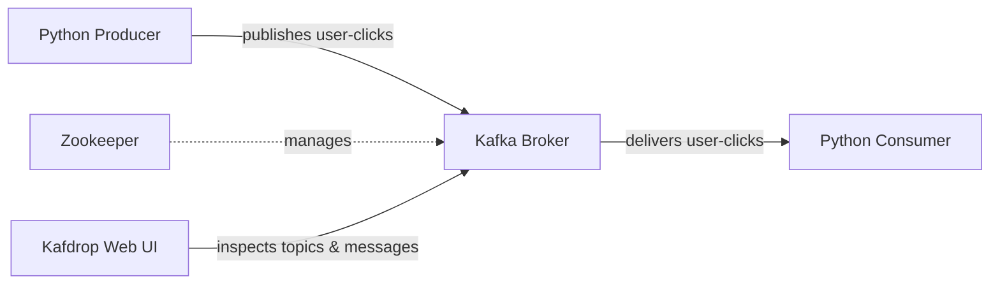

# Microservices Kafka Docker

A local, fully dockerized event-streaming platform built on Apache Kafka and orchestrated with Docker Compose. A Python **producer** publishes simulated user-click events to a Kafka topic every two seconds, a Python **consumer** ingests them in real time, and **Kafdrop** provides a web UI to inspect the topic and its messages. The Kafka broker is coordinated by Zookeeper.

## Architecture



| Service | Image | Purpose |
|---|---|---|
| `zookeeper` | `confluentinc/cp-zookeeper:7.4.0` | Coordination service backing the Kafka broker |
| `kafka` | `confluentinc/cp-kafka:7.4.0` | Message broker; hosts the `user-clicks` topic |
| `producer` | local build (`python:3.9-slim`) | Emits a user-click JSON event to `user-clicks` every 2s |
| `consumer` | local build (`python:3.9-slim`) | Consumes `user-clicks` from the earliest offset, prints payloads |
| `kafdrop` | `obsidiandynamics/kafdrop` | Web UI for inspecting topics and messages |

All services communicate over a custom Docker bridge network named `kafka-net`. The Kafka broker advertises a dual listener: `kafka:29092` for inter-container traffic and `localhost:9092` for host access.

## Prerequisites

- **Docker Desktop** — includes the Docker Engine and Docker Compose v2.
- **Python 3.9+** — only needed if you want to run the producer/consumer scripts outside Docker. The stack itself runs entirely in containers and needs no local Python.

## Project structure

```
microservices-kafka-docker/
├── docker-compose.yml        # Orchestrates all five services on kafka-net
├── README.md
├── producer/
│   ├── Dockerfile
│   ├── requirements.txt      # kafka-python==2.0.2
│   └── producer.py           # Publishes user-click events every 2s
└── consumer/
    ├── Dockerfile
    ├── requirements.txt      # kafka-python==2.0.2
    └── consumer.py           # Consumes user-clicks, auto_offset_reset='earliest'
```

## Quickstart

From the project root:

```bash
docker compose up -d --build
```

This builds the producer and consumer images, pulls the Kafka / Zookeeper / Kafdrop images, and starts every service in detached mode. The producer and consumer include connection-retry logic, so they wait for Kafka to become ready before entering their main loops.

Watch the events flow in the logs:

```bash
docker compose logs -f producer consumer
```

Expected output:

- `producer` → `[producer] Sent to 'user-clicks': {'event_id': 1, 'action': 'click', 'platform': 'web'}`
- `consumer` → `[consumer] Received: {'event_id': 1, 'action': 'click', 'platform': 'web'}`

## Monitoring with Kafdrop

Kafdrop's web UI is exposed on the host:

> **http://localhost:9000**

Once open you can:

- View all topics (you will see `user-clicks`)
- Inspect a topic's partitions, offsets, and consumer groups
- Browse the live JSON message payloads as they stream in

## Stopping the stack

```bash
docker compose down
```

This stops and removes the containers and the `kafka-net` network while keeping the pulled/built images cached for a fast next start.

## Configuration notes

| Host port | Service | Endpoint |
|---|---|---|
| `2181` | zookeeper | `localhost:2181` |
| `9092` | kafka (host listener) | `localhost:9092` |
| `29092` | kafka (container listener) | `kafka:29092` |
| `9000` | kafdrop | `localhost:9000` |
